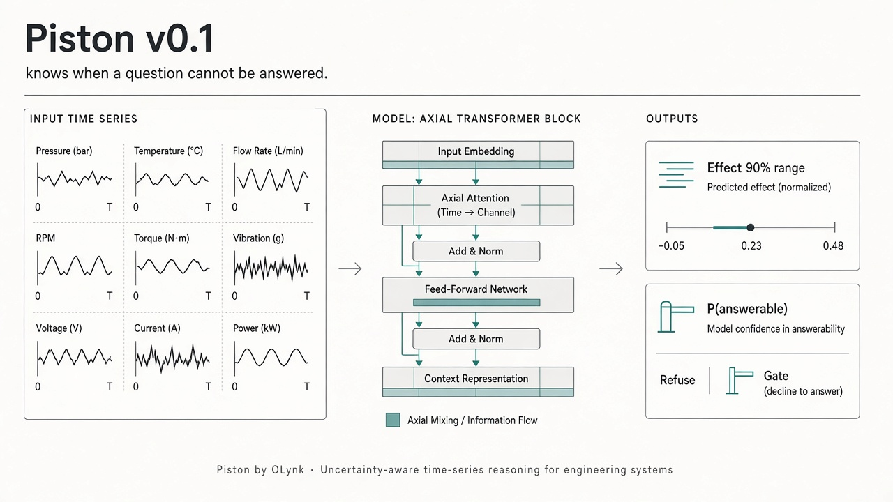
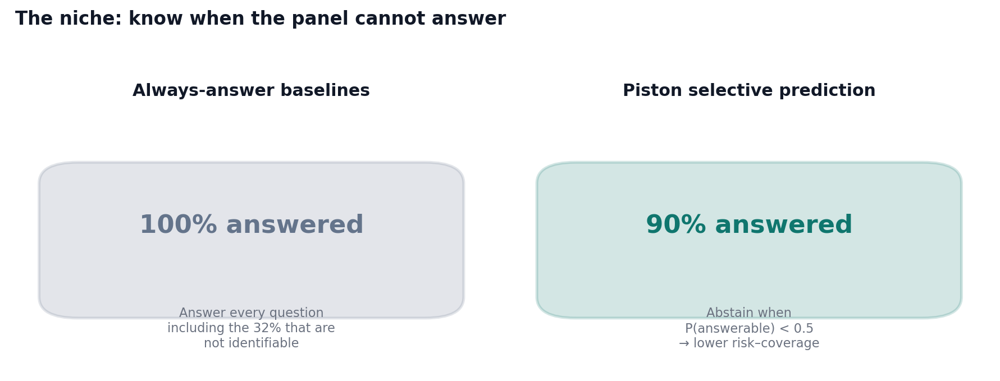
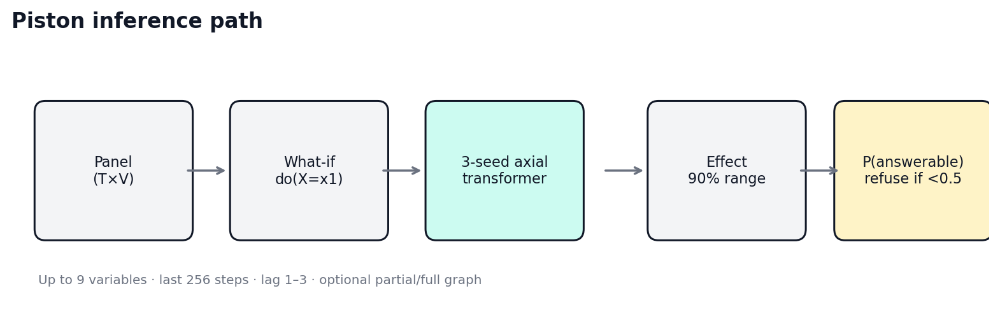
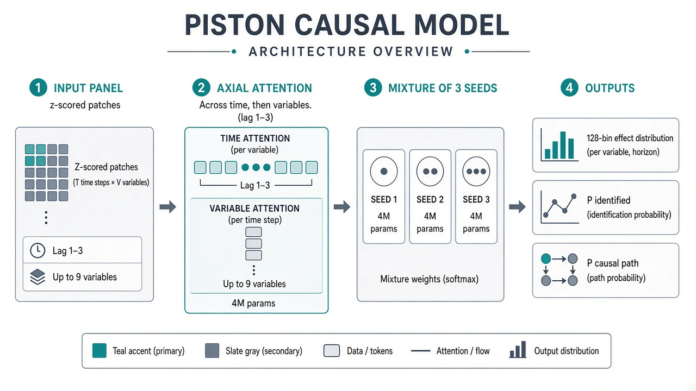
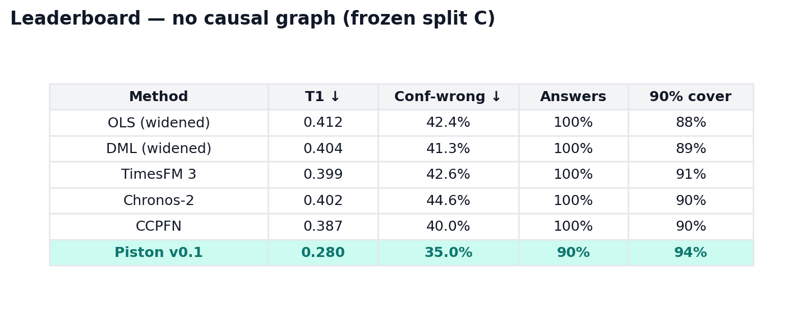
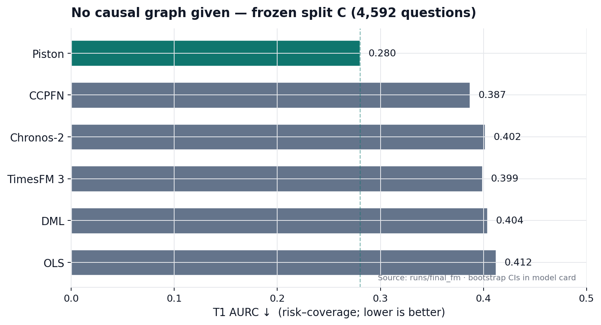
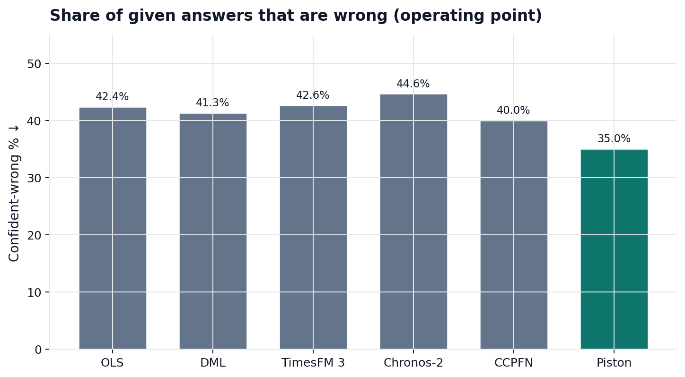
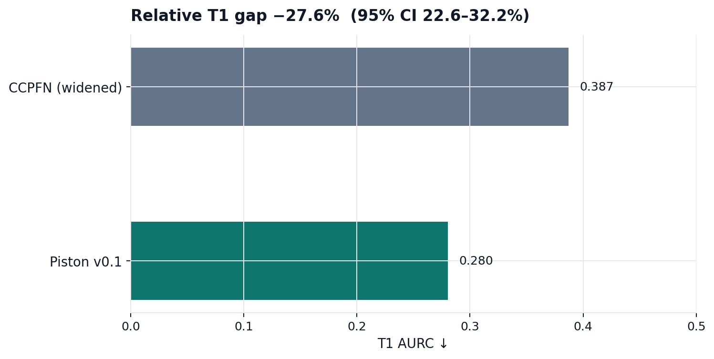
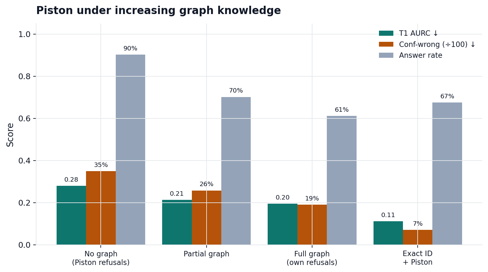

---
license: apache-2.0
library_name: pytorch
tags:
  - causal-inference
  - time-series
  - uncertainty
  - selective-prediction
  - in-context-learning
pipeline_tag: tabular-regression
---

# Piston v0.1

> Weights live on Hugging Face: https://huggingface.co/OlynkAI/piston-v0.1 (place them in `weights/`).

**A small causal model for time series that knows when a question cannot be answered.**

<p align="center">
  
</p>

Give it a table of measurements over time (up to 9 variables, 128+ steps) and a what-if question:

> At some step *t*, set `treatment` to *x1* instead of *x0*. How much does `target` change *k* steps later (k = 1, 2, 3)?

It returns the effect with a 90% range, the probability that the data can answer the question at all (`p_answerable`), and the probability that the treatment reaches the target at that lag. It reads the data in context: no fitting per dataset.

- 3-seed ensemble of a ~4M-parameter axial transformer (12M parameters in total), trained only on synthetic worlds.
- A research release by [OLynk](https://huggingface.co/OlynkAI). Apache-2.0.
- Reproduce package: [github.com/OlynkAI/piston](https://github.com/OlynkAI/piston)

<p align="center">
  
</p>

## How it works

<p align="center">
  
</p>

<p align="center">
  
</p>

## Results

Frozen benchmark (included): 4,592 questions in 998 synthetic worlds from 23 world families **never seen in training**. Exact true effects (common-random-number simulation) and exact labels for whether each question is answerable from the data (32% are not). 95% intervals resample whole worlds (2,000 bootstrap resamples).

**T1** is the area under the risk–coverage curve: answers sorted from most to least confident, risk = share wrong; lower is better. An answer is **wrong** if the true effect is outside the 90% range, the sign is wrong on a real effect, or the question was unanswerable and the method answered anyway. **Confident-wrong** = share of given answers that are wrong. Every method's ranges were widened by the same rule, fitted on held-out training data (never the benchmark), until they cover 90%; Piston needed no widening.

### No causal graph given

<p align="center">
  
</p>

<p align="center">
  
</p>

<p align="center">
  
</p>

<p align="center">
  
</p>

| Method | T1 ↓ | T1 95% | Confident-wrong ↓ | Answers | 90% range covers |
|---|---|---|---|---|---|
| OLS on all history (widened ×1.37) | 0.412 | 0.387–0.439 | 42.4% | 100% | 88% |
| Double machine learning, random forests (widened ×1.53) | 0.404 | 0.378–0.430 | 41.3% | 100% | 89% |
| TimesFM 3, Google (widened, see notes) | 0.399 | 0.375–0.424 | 42.6% | 100% | 91% |
| Chronos-2, Amazon 2025 (widened, see notes) | 0.402 | 0.377–0.425 | 44.6% | 100% | 90% |
| CCPFN, Layer6 2026 (widened ×6.99, see notes) | 0.387 | 0.363–0.412 | 40.0% | 100% | 90% |
| **Piston v0.1** | **0.280** | 0.258–0.304 | **35.0%** | 90% | 94% |

T1 27.6% lower than the strongest baseline (95% interval of the gap: 22.6–32.2%).

### Causal graph known

When the full graph is known, an exact identification algorithm can decide which questions are answerable. The best use of Piston then is as the estimator behind that algorithm.

<p align="center">
  
</p>

| Method | T1 ↓ | T1 95% | Confident-wrong ↓ | Answers |
|---|---|---|---|---|
| Exact identification + OLS (widened) | 0.195 | 0.177–0.212 | 14.6% | 67% |
| Exact identification + DML (widened) | 0.185 | 0.168–0.202 | 13.1% | 67% |
| Exact identification + TimesFM 3 (widened) | 0.209 | 0.192–0.225 | 15.0% | 67% |
| Exact identification + Chronos-2 (widened) | 0.204 | 0.188–0.219 | 18.0% | 67% |
| Exact identification + CCPFN (widened) | 0.178 | 0.162–0.194 | 11.0% | 67% |
| Piston with the graph as input (its own refusals) | 0.195 | 0.177–0.214 | 19.1% | 61% |
| **Exact identification + Piston** | **0.112** | 0.101–0.124 | **7.1%** | 67% |

T1 37.0% lower than the strongest baseline (gap 29.4–44.1%). Which Piston ranges to use in this setup (none / partial / full graph input) was chosen on held-out training data: the no-graph ranges.

With a partial graph (each pair of variables revealed with probability 0.2–0.8) as input: T1 0.213 (0.194–0.234), confident-wrong 25.8% at 70% answered. No classical baseline for this setting yet.

## Quick start

```bash
pip install torch numpy huggingface_hub
huggingface-cli download OlynkAI/piston-v0.1 --local-dir piston-v0.1 && cd piston-v0.1
```

```python
import numpy as np
from piston import Piston

pst = Piston.from_pretrained(".")              # the downloaded folder
panel = np.loadtxt("my_data.csv", delimiter=",")   # (steps, variables), oldest row first
out = pst.predict(panel, treatment=0, target=2, lag=1, x0=10.0, x1=12.0)
if out["p_answerable"] < 0.5:
    print("Cannot be answered from this data")
else:
    print(f"effect {out['effect']:.3f}, 90% range [{out['lo90']:.3f}, {out['hi90']:.3f}]")
```

Optional graph knowledge, variables × variables: `edges[i, j]` 0 unknown, 1 "i causes j", 2 "i does not cause j"; `hidden[i, j]` 0 unknown, 1 "a hidden cause drives both", 2 "no hidden common cause".

Reproduce the tables: `python evaluate_benchmark.py --weights weights --bench benchmark --boot 2000`. Score your own method by writing (q05, q50, q95, p_answerable) per benchmark question and calling `piston.metrics.report`.

## What is in this repository

| Path | Contents |
|---|---|
| `assets/` | Figures: hero, architecture, leaderboard charts and tables |
| `weights/seed0.pt`, `seed1.pt`, `seed2.pt` | The three ensemble members |
| `piston/` | Model, inference API, benchmark loader, metrics |
| `benchmark/split_C.npz` | The frozen benchmark: panels, questions, true effects, answerability labels, true graphs |
| `benchmark/baseline_predictions.npz` | Baseline predictions behind the tables (widened intervals): OLS, DML, CCPFN, Chronos-2, TimesFM 3 |
| `evaluate_benchmark.py` | Reproduces the leaderboard |

The training environment and training data are not part of v0.1.

## Limitations

- **Synthetic worlds only.** The benchmark families are unseen, but they come from the same generator as the training worlds. That is a home advantage over CCPFN, which never saw this generator. No real-data evaluation yet.
- **Does not transfer to contact physics.** On simulated robot pushing (one-sided contact, feedback control), no model we tried, this one included, beat predicting zero.
- **Its refusal does not detect unfamiliar data.** `p_answerable` says whether a question is answerable in worlds like its training worlds; it does not flag data that look nothing like them.
- **With a known graph, use exact identification for refusals.** The learned refusal is weaker (see table).
- **Scope:** up to 9 variables, effects up to 3 steps ahead, interventions on a single variable at a single step, one entity per panel, stationary series.
- **Confident-wrong is still 35% without a graph.** Our own target was half the best baseline's rate; v0.1 does not reach it.

## Notes on the baselines

- Same inputs for every method: the last 256 steps; covariates = every variable at lags 1–7 plus same-step variables other than treatment and target.
- **CCPFN:** effect = mean over rows of the predicted outcome at *x1* minus at *x0*. Its 90% range is our construction (8 block-bootstrap resamples of the context), not CCPFN's own uncertainty output; it covered 42% before widening. CCPFN's point estimates are competitive (median normalised error 0.042 vs 0.048 for a single Piston seed).
- **Chronos-2 and TimesFM 3** (time-series foundation models), asked the usual way: at 16 time points, X at step t is set to x0 and to x1 as a known future covariate (its actual values at later steps kept), every other variable is a past covariate, and the effect is the difference of the median forecasts of Y at t + k, averaged over the 16 points. Their 90% range is our construction (spread over the 16 points), so their widening factors (20.7 and 55.6) reflect it, not the models' own uncertainty. They get the direction of real effects right 62% (Chronos-2) and 72% (TimesFM 3) of the time; median error 0.056 and 0.053. Other ways of prompting them may do better.
- **DML:** partially linear model, random-forest nuisances (60 trees), 5 contiguous cross-fitting folds, sandwich standard errors.
- Intervals are conditional on the trained models; seed-to-seed variation enters only through the 3-seed ensemble.

## Citation

```bibtex
@misc{piston2026,
  title  = {Piston v0.1: a causal model for time series that knows when a question cannot be answered},
  author = {Chenna, Sai Sathvik and OLynk},
  year   = {2026},
  url    = {https://huggingface.co/OlynkAI/piston-v0.1}
}
```
